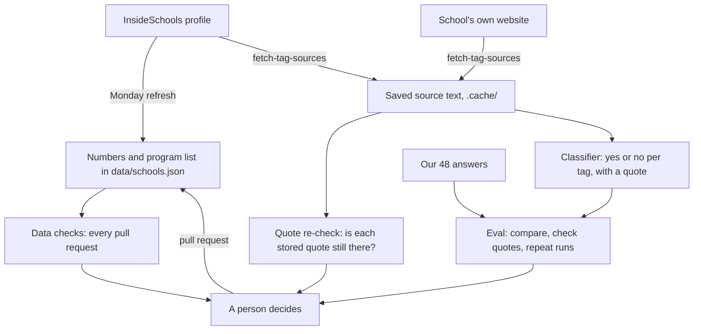

# How the evals work

An eval answers one question: **is what we show families about a school still right, and decided the same way
for every school?** This doc walks through the evals end to end. Commands and test counts are in
[testing.md](testing.md); the rules for each tag and number are in [data-sources.md](data-sources.md).

## The idea in one picture

What a family sees about a school comes from three kinds of facts. Each kind gets the cheapest check that can
actually judge it.

| Kind of fact | Examples | Who decides it | How it is checked | When | Cost |
|---|---|---|---|---|---|
| A number from a source | Test results, feel safe, bullying, school size | The source | Pulled from the source and compared with ours | Every Monday | Free |
| A lookup in a list | Honors, dual language, special-ed support, small school | A rule in code | The rule is re-run against the school's program list | Every pull request, and after each Monday pull | Free |
| A reading of written text | Music & band, arts, science & tech | A person, by a written rule | The stored quote is re-found on its page; a model gives a second opinion, scored against our answers | By hand: each August and when a rule changes | A few model calls |

Only the last row needs a model. A program list either has a dual language program or it doesn't; code gives the
same answer every time. A sentence like "offers theater, dance and music" has to be read, and two readers can
disagree. That is where a model helps, and where it has to be measured before it is trusted.

Nothing in this picture changes a tag by itself. Every check ends at a person.

## Step 1: every tag says what it rests on

Each school in `data/schools.json` carries two things besides its tags:

- `listed`: its program list from InsideSchools (name and admissions method), plus the Staff Pick for Special
  Ed mark. The Monday refresh keeps it current.
- `tag_evidence`: for every tag, the program name or a short quote that supports it, and where the quote is
  from (the InsideSchools review, or a page of the school's own website).

This is what makes the rest possible. A tag with a recorded reason can be re-checked; a tag someone once typed
cannot.

## Step 2: the checks that need no model

**The data checks** (`npm run check:data`, on every pull request) stop a tag with no evidence, evidence left
behind for a removed tag, and evidence naming a program the school doesn't list.

**The program-list rule** (`scripts/lib/tag-rules.js`) decides honors, dual language and special-ed from
`listed`: a screened program; a dual language program; an ASD Nest, Horizon or ACES program, a D75 Inclusion
program, or the staff pick. If a tag and the list disagree, the data checks warn. So when InsideSchools adds or
drops a program, the next Monday pull request says which tag to look at.

**Small school** is never stored. It is worked out from the school's size each time, so it cannot go stale.

**The quote re-check** (`npm run fetch:tag-sources`) fetches each school's InsideSchools page and website pages
again and looks for every stored quote, word for word. A quote that is gone means the page changed or the tag
may no longer hold. It is free and needs no key.

## Step 3: the classifier

For music & band, arts and science & tech, `scripts/lib/tag-classifier.js` asks a model about one school at a
time. It is given:

- the three written rules, word for word as in [data-sources.md](data-sources.md#program-tags) (a test fails if
  the two drift apart);
- the school's saved source text: program list, review, home page and the pages its evidence points at.

It answers yes or no for each tag, with the exact words it rests on and one sentence of reasoning. It is told to
use only what the text says, never the school's name or what it knows from elsewhere, so a tag is never assumed.

It proposes. It cannot write to the data.

## Step 4: the eval of the classifier

A model's answer is only useful if we know how often it matches a careful person. The eval measures that.

**The golden answers.** `tests/evals/tag-cases.json` holds our own decision for each of 16 schools × 3 tags: 48
answers, 22 yes and 26 no, with a note on each judgment call (for example, a Federal Magnet program alone does
not earn science & tech).

**One run.** For each school the runner (`scripts/eval-tags.mjs`) calls the classifier, then grades the answer
by code. No model grades another model.

**Three things are graded:**

| Check | Question | Why it matters |
|---|---|---|
| Agreement | Does each yes or no match ours? | The headline. Reported per tag, not as one number |
| Quotes | Is every quote behind a "yes" in the source text, word for word? | Catches a made-up reason, even when the answer happens to be right |
| Consistency | Run each school 3 times: does any answer change? | An answer that flips is a guess, whichever way it lands |

**Reading the per-tag table.** Wrong answers are counted in two columns because they hurt families differently:

- **Precision:** of the times it said yes, how often we agree. Low precision means it hands out tags a school
  hasn't earned, so the school ranks too high for a family who picked that program.
- **Recall:** of our yeses, how many it found. Low recall means it misses real programs, so the school is hidden
  from that family.
- **Specificity:** of our nos, how many it left alone.

**Failed calls are not wrong answers.** A call that errors, is refused or is cut off goes to `errors.jsonl` and
is retried next time. It never counts for or against the model.

**The eval checks itself first.** Before any paid call: our own answers pushed through the grader must score
100%; answering "no" to everything must fail; an induced error must land in `errors.jsonl`. All three were run
and pass.

## Step 5: what happens with the result

The summary lists three kinds of disagreement, and each means something different:

| The summary says | Likely meaning | What to do |
|---|---|---|
| Same answer every run, but not ours | Either the model is wrong, or it found something we missed, or our rule is unclear | Read its quote. If it is right, change the tag with that quote as evidence. If it is wrong, sharpen the rule's wording |
| Answer changed between runs | The text is borderline under the rule as written | Decide it yourself and record why in the case's note |
| Quote not found in the source | The model invented or reworded its reason | Don't trust that answer; if it recurs, tighten the prompt |

A tag changes only through a normal pull request, with its evidence, decided by a person.

## When each part runs

| Part | When | Who starts it |
|---|---|---|
| Number and program-list pull | Every Monday | GitHub Actions (*Refresh data*) |
| Data checks, including the program-list rule | Every pull request | GitHub Actions |
| Quote re-check | Each August, and whenever you edit tags | You |
| Classifier eval | Each August, and when a tag rule, the prompt or the model changes | You, with your own API key |

The classifier never runs in GitHub Actions. It needs an Anthropic API key, and the public repository holds no
secrets ([secrets.md](secrets.md)).

## What the eval cannot tell you

- **It is small.** 16 schools means one answer is about 2 points. Treat the table as a list of cases to read,
  not as a score to chase.
- **The golden answers are ours.** It measures agreement with our decisions, not truth. If we were wrong
  about a school, a correct model looks wrong.
- **The sources are uneven.** InsideSchools reviews date from 2017 to 2021 and some schools have none. School
  websites vary from detailed to nearly empty. No tag can be better than its source.
- **The model reads more than we did.** It sees each school's home page, which the original decisions did not
  always use. Some "wrong yeses" will be real finds.

## Where this goes next

The same pattern (a written rule, stored evidence, golden answers, grading by code, a person deciding) is the
plan for the highlights and concerns we write by hand: a guideline for what earns a bullet, a model drafting
them the same way for every school, and an eval that checks each draft against its source.
